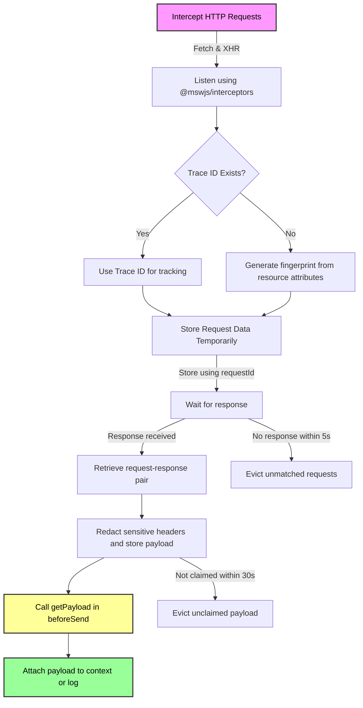

# **Datadog RUM Interceptor**

**A lightweight request/response interceptor for Datadog RUM, providing enhanced payload visibility for debugging and monitoring.**

## **Features**

- Intercepts Fetch & XHR requests
- Captures request & response payloads
- Seamlessly integrates with Datadog RUM
- Uses Trace ID if available, falls back to fingerprinting
- Automatically evicts unmatched requests after 5 seconds and unclaimed payloads after 30 seconds
- Redacts credential headers (`Authorization`, `Cookie`, `Set-Cookie`, etc.) by default
- Ignores requests to Datadog domains (RUM/log intake on every Datadog site)
- Users can modify the payload data as needed to remove or redact other sensitive information, such as request/response bodies.
  - [Sensitive Data Scanner](https://docs.datadoghq.com/sensitive_data_scanner/) can also be used for RUM events within Datadog.

---

## **Installation**

### **Install via NPM**

```bash
npm install @kyletaylored/datadog-rum-interceptor
```

Using the package in Node.js (for example, in tests or server-side rendering) requires Node.js 22 or later.

### **Load via CDN**

For direct use in the **browser**:

```html
<script src="https://www.unpkg.com/@kyletaylored/datadog-rum-interceptor/dist/umd/index.js"></script>
```

---

## **Usage**

### **In a Browser**

```javascript
const DRI = window.DD_RUM_INTERCEPTOR.init({ debug: true });

window.DD_RUM.init({
  applicationId: "YOUR_APP_ID",
  clientToken: "YOUR_CLIENT_TOKEN",
  beforeSend: (event, context) => {
    if (
      event.type === "resource" &&
      ["xhr", "fetch"].includes(event.resource.type)
    ) {
      const payload = DRI.getPayload({ event, context });
      if (payload) {
        event.context.payload = payload;
      }
    }
    return true;
  },
});
```

---

### **With a Bundler (npm)**

```javascript
import datadogRumInterceptor from "@kyletaylored/datadog-rum-interceptor";
import { datadogRum } from '@datadog/browser-rum'

const DRI = datadogRumInterceptor.init({ debug: true });

datadogRum.init({
  applicationId: '<DATADOG_APPLICATION_ID>',
  clientToken: '<DATADOG_CLIENT_TOKEN>',
  ...
  beforeSend: (event, context) => {
    if (event.type === 'resource' && ['xhr', 'fetch'].includes(event.resource.type)) {
      const payload = DRI.getPayload({ event, context });
      if (payload) {
        event.context.payload = payload;
      }
    }
    return true;
  },
})

```

---

## **How It Works**



1. **Intercepts HTTP requests**
   - Uses `@mswjs/interceptors` to listen for **Fetch & XHR requests**.
2. **Links Requests & Responses**
   - If **Trace ID exists**, it’s used for tracking.
   - If **Trace ID is missing**, a **fingerprint** is generated from resource attributes (best effort).
3. **Stores data temporarily**
   - **Request data is stored using `requestId`** until the response is received.
   - **Unmatched requests are automatically evicted after 5 seconds**.
   - **Payloads not claimed by `getPayload` are evicted after 30 seconds**.
4. **Redacts sensitive headers**
   - Credential headers such as `Authorization` and `Cookie` are replaced with `[REDACTED]` before the payload is stored (see `redactHeaders`).
5. **Retrieves payload in `beforeSend`**
   - The `getPayload({ event, context })` method **automatically** finds and attaches the payload.

---

## **API Reference**

### **`init(config: object)`**

Initializes the interceptor.

```javascript
const DRI = window.DD_RUM_INTERCEPTOR.init({ debug: true });
```

| Option          | Type       | Default                  | Description                                                                 |
| --------------- | ---------- | ------------------------ | --------------------------------------------------------------------------- |
| `debug`         | `bool`     | `false`                  | Enable logging for debugging                                                |
| `redactHeaders` | `string[]` | Common credential headers | Header names (case-insensitive) whose values are replaced with `[REDACTED]`. Pass `[]` to disable. |

The default `redactHeaders` list is `authorization`, `proxy-authorization`, `cookie`, `set-cookie`, `x-api-key`, `x-auth-token`, `x-csrf-token`, and `x-xsrf-token`. Request and response **bodies are not redacted**.

---

### **`getPayload({ event, context }): object | null`**

Retrieves the **request/response payload** for a given Datadog RUM event.

```javascript
const data = DRI.getPayload({ event, context });
console.log(data);
```

| Parameter   | Type             | Description                                        |
| ----------- | ---------------- | -------------------------------------------------- |
| `event`     | `object`         | The Datadog RUM event object.                      |
| `context`   | `object`         | The Datadog RUM context object.                    |
| **Returns** | `object \| null` | The extracted payload data or `null` if not found. |

---

### **`stop()`**

Stops the interceptor and clears any stored request/response data.

```javascript
DRI.stop();
```

---

## **Troubleshooting**

### **No request data is being captured**

- Ensure **interceptor is initialized before Datadog RUM**.
- Verify `beforeSend` is correctly configured.

### **Requests with Trace ID are not matching**

- Check if Datadog **injects trace headers** (`x-datadog-trace-id`).
- If missing, the **fingerprinting fallback** will be used.

### **Headers show `[REDACTED]`**

- Credential headers are redacted by default. Pass a custom list, e.g. `init({ redactHeaders: ['authorization'] })`, or `init({ redactHeaders: [] })` to disable redaction.

### **Payloads are missing for slow or late events**

- Payloads that aren't claimed by `getPayload` within **30 seconds** are evicted. Make sure `getPayload` is called from `beforeSend`.

---

## **Development**

```bash
npm ci
npm run build   # Build ES, CJS, and UMD bundles into dist/
npm test        # Run the Vitest suite (unit + fetch/XHR integration tests)
```

CI runs `npm audit`, the build, and the tests on every push and pull request.

### **Releasing**

Releases are automated by the [release workflow](.github/workflows/release.yml) and triggered by merging a version bump to `main`.

1. As changes land, add entries under `## [Unreleased]` in [`CHANGELOG.md`](CHANGELOG.md), which follows [Keep a Changelog 1.1.0](https://keepachangelog.com/en/1.1.0/). Group entries under `### Added`, `Changed`, `Deprecated`, `Removed`, `Fixed`, or `Security`, in that order. CI runs `npm run release:check` to enforce the format.
2. On a branch, run:

   ```bash
   npm run release:prepare -- <patch|minor|major|x.y.z>
   ```

   This bumps the version in `package.json` and `package-lock.json` and moves the Unreleased entries into a dated version section. Open a pull request titled `Release x.y.z`.
3. Merge the pull request after CI passes. The release workflow then:
   1. Checks whether the version is already tagged. If it is, it does nothing.
   2. Validates the changelog, installs dependencies without install scripts, verifies dependency signatures, audits, builds, and tests.
   3. Builds the package twice and fails if the two tarballs aren't byte-identical.
   4. Signs a build provenance attestation for the tarball.
   5. Stages **that same tarball** on npm with `npm stage publish`, using [trusted publishing](https://docs.npmjs.com/trusted-publishers) (OIDC, with provenance). No npm token is stored anywhere. Prerelease versions (`x.y.z-rc.1`) go to the `next` dist-tag.
   6. Creates the git tag and GitHub release with the changelog notes, the tarball, and `SHA256SUMS`.
4. Approve the staged version with 2FA: open the package's **Staged Packages** tab on npmjs.com and click **Approve**, or run `npm stage list` and `npm stage approve <stage-id>`. The version isn't public on npm until you approve it.

If a run fails partway through, fix the cause and use **Re-run failed jobs**, which only repeats the steps that didn't succeed. Once the git tag exists, the workflow treats that version as done.

See [SECURITY.md](SECURITY.md) for how to verify a release.

---

## **Disclaimer**

This software is provided "as is," without warranty of any kind, express or implied, including but not limited to the warranties of merchantability, fitness for a particular purpose, and non-infringement. In no event shall the authors, contributors, or their employers be liable for any claim, damages, or other liability, whether in an action of contract, tort, or otherwise, arising from, out of, or in connection with the software or the use or other dealings in the software.

By using this software, you acknowledge and agree that you assume all risks and liabilities associated with its use, and you waive any and all claims against the authors, contributors, and their employers.
